<div align="center">


# PerRoute

**Route only the applications you choose through your proxy. Everything else stays on your regular connection.**

A modern Windows client for VLESS, VMess, Trojan and Shadowsocks, built on [Xray-core](https://github.com/XTLS/Xray-core).


[Download](#download) · [What's new](#whats-new-in-351) · [Features](#features) · [Tour](#tour) · [Speed](#speed) · [Build from source](#build-from-source)

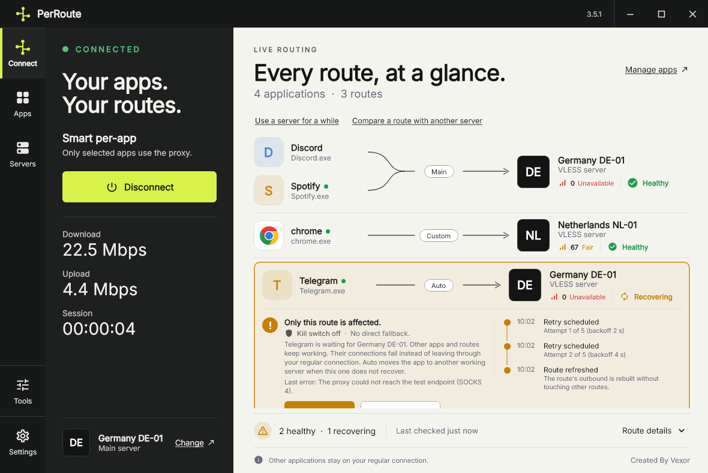

</div>

---

## Why PerRoute

Most proxy clients are all-or-nothing: either the whole system goes through the tunnel or nothing does. PerRoute is built around the opposite idea. You pick the applications that need the tunnel; the rest of the machine keeps its normal, direct connection. No per-application proxy settings and no launching applications from inside the client. For browsers there is an optional extension that does the same per site: choose which sites use the tunnel, which open directly and which are blocked.

When you do want everything proxied, System proxy and Local proxy modes are one click away.

## What's new in 3.5.1

- **Faster downloads and YouTube for routed apps.** The new **Block QUIC** setting (*Settings > Routing*, on by default) makes routed apps use HTTPS over TCP instead of QUIC, the same as behind a system proxy. QUIC carried inside a server's TCP connection was often much slower. See [Speed](#speed).
- **Automatic updates.** PerRoute checks the official releases when it starts and every six hours, downloads and verifies a new version in the background, and asks once to restart. The installer then updates PerRoute in place and reopens it. No link needs to be entered; turn it off in *Settings > Updates*.
- **Microsoft Store apps after an update.** Store apps move to a new folder on every Store update. PerRoute now finds the installed version, so they keep their route and their real icon, and are listed once.
- **Dark logos stay visible** in the dark theme, and icons are sharper at 150% scaling.
- **Layout fixes.** Long server and app names no longer run into the **Main** badge or the next column, and the title bar of the New design starts with the logo.

Full notes: [docs/releases/v3.5.1.md](docs/releases/v3.5.1.md).

## Features

| | |
|---|---|
| **Per-application routing** | Route arbitrary Windows applications, including ones with no proxy settings of their own. Already-running applications are picked up without being restarted, and Microsoft Store apps keep their route after the Store updates them. |
| **Two designs, light and dark** | **New** (a narrow rail with a detail panel) and **Simple** (a wide menu with every section), each in a light and a dark theme. Switch in *Settings > General*; nothing else changes. |
| **A server per app (optional)** | Advanced routing lets each selected application follow the main server, use a server you pick, or let PerRoute pick one automatically. It is off by default. |
| **Network quality score** *(3.0)* | Every server gets an explainable 0–100 score from latency, jitter, success rate, stability and tunnel setup time, with a confidence level and freshness. Unmeasured servers are shown as Unknown, never as healthy. |
| **Auto server per app** *(3.0)* | An application in Auto mode gets its own route to the best measured server. It changes only when another server is clearly better and a cooldown has passed, fails over when its server stops working, and never falls back to the direct route. |
| **Independent route recovery** *(3.0)* | Every live route is checked through its own port and recovered on its own, with bounded retries. A failing route does not restart or interrupt the others. |
| **Per-app bandwidth limits** *(3.0)* | Download and upload limits per application, shared by all of its connections (TCP and UDP), enforced by PerRoute's traffic gateway. |
| **Connection inspector** *(3.0)* | Each selected app's live connections with destination, protocol, route, matched rule and traffic. What is configured, what the core was observed doing, and what a route check verified are always shown apart. |
| **Backup and restore** *(3.0)* | Portable backups, optionally encrypted with a password, with a preview, path remapping for other computers, Merge or Replace, a rollback snapshot and Undo. |
| **Network Time Machine** *(3.5)* | Snapshots of the network settings PerRoute touches, a comparison that says who changed what, and a restore that undoes only PerRoute's own leftovers. **PerRoute Recovery** does the same even when PerRoute does not open. |
| **Safe update and rollback** *(3.5)* | The installer keeps the version it replaces; a version that cannot start is noticed and you can go back without a download. |
| **Temporary servers** *(3.5)* | One app on another server for a while, from the app, the Connection screen, a server or the tray. It goes back by itself; nothing permanent changes. |
| **Compare with a live route** *(3.5)* | A candidate server and a live route open the same sites side by side, without touching the route. |
| **Routing recipes** *(3.5)* | Share rules and app routes as a file or a line of text, without servers, links, passwords or folders. Import with a full preview and Undo. |
| **Browser workspaces** *(3.5)* | Separate browser profiles, each on a route of its own, with DNS, QUIC and WebRTC kept inside it. |
| **Local network** *(3.5)* | See your networks and devices, keep local names local, and block local devices for routed apps on networks you do not trust. |
| **Connection Doctor and Safety Center** *(3.5)* | Why something does not connect, with repairs you confirm; and real tests that protection works as configured. |
| **Subscription intelligence** *(3.5)* | Usage, quota, expiry and update history of every subscription, with warnings for expired, exhausted, failing or suddenly changed ones. |
| **Gaming test** *(3.5)* | Steady latency, jitter, packet loss and UDP support per server, and a score built for games. |
| **Block QUIC** *(3.5.1)* | Routed apps use HTTPS over TCP instead of QUIC, which is usually much faster through a tunnel. On by default, one switch to turn off. |
| **Browser extension** | PerRoute inside Chrome, Edge, Brave and Vivaldi, with or without the app: site-by-site routing (Tunnel, Direct, Block, a server per site, temporary rules), server tests and quality scores, failover, kill switch, traffic, presets, recipes, profiles, a connection doctor, a request inspector and encrypted backups. See [Browser extension](#browser-extension). |
| **Quick Route** | Right-click a program or its shortcut in Explorer and choose **Route with PerRoute**: pick the main server, a server of its own or Auto, and save, without opening Apps. |
| **LAN Bridge** | Share this computer's connection with your phone, tablet or TV on the same Wi-Fi, for an hour, four hours or until you stop. Each device gets its own port, password and setup code, and can be removed on its own. |
| **Resource saving** | On battery or a metered network, background server checks run less often, automatic speed tests pause and updates wait. Routes, route recovery and the kill switch are never weakened. |
| **Three connection modes** | Smart per-app, System proxy, and Local proxy (SOCKS5 + HTTP). |
| **Subscriptions** | Import by URL, pasted share links, Xray JSON, or QR code (image, clipboard, or camera). Updates keep your favorites, tags and selection. |
| **Latency and speed tests** | Endpoint ping, a real tunnel test, and a download speed test per server, with sorting and filtering. |
| **Live switching** | Change servers while connected without restarting your applications. Where possible only the main route is replaced, so other routes keep their connections. A failed switch rolls back automatically. |
| **Auto reconnect and failover** | Recovers after sleep or network changes and moves to a working server when the active one stops responding. |
| **Per-app kill switch** | Keeps selected applications offline whenever their tunnel is unavailable. Other applications are unaffected. |
| **Routing rules** | Per-application rules by domain, IP/CIDR or port with Proxy, Direct and Block actions. First match wins. |
| **One-click scenarios** | Work, Gaming and Streaming presets that set automation and add a small rule set on top of yours. |
| **Profiles** | Save applications, server, mode and rules together and switch between them. |
| **Connection diagnostics** | Check every route on its own: the public IP it exits from and when it last passed or failed. See your system DNS resolvers, which rules are loaded in the running core, and which rule a destination will hit. |
| **Traffic history** | Live speed graph plus daily, monthly and per-application totals. Stored locally; destinations are never recorded. |
| **Quick Access** | A compact tray panel to connect, switch the main server or jump to the fastest one. |
| **Safe recovery** | Windows proxy settings are restored after a crash, forced close, or sudden restart. |
| **Automatic, signed updates** | New versions are found, downloaded and verified by themselves; you only choose when to restart. Update manifests are verified against a pinned Ed25519 key; downloads are checked by size and SHA-256. |

## Download

Get the latest build from the [Releases](https://github.com/AliMirzad/PerRoute/releases/latest) page.

| Package | Use it when |
|---|---|
| `PerRoute-Setup-3.5.1.exe` | You want everything, including Smart per-app mode. The installer asks for Administrator approval once; choose the app, the browser extension or both. |
| `PerRoute-Portable-3.5.1.zip` | You want a no-install build. Extract the folder and run `PerRoute.exe`. System proxy and Local proxy work out of the box; Smart per-app works only if the per-app engine is already installed. |

**Requirements:** Windows 10 or 11, 64-bit. The Java runtime and Xray core are bundled; nothing else needs to be installed.

Verify a download against the SHA-256 values published with each release:

```powershell
Get-FileHash .\PerRoute-Setup-3.5.1.exe -Algorithm SHA256
```

## Quick start

1. Open **Servers**, choose **Add servers**, and paste your subscription URL (or use **Paste links** or **QR code**). Review the list, then add it.
2. Select a server and choose **Use as main server**. Latency appears automatically; the best servers are speed-tested in the background.
3. Open **Apps**, tick the programs that should use the tunnel, and choose **Save changes**.
4. Open **Connection** and press **Connect**.

## Tour

PerRoute has two designs over the same app. **New** (the default) has a narrow rail with Connect, Apps and Servers, plus Tools (Rules, Profiles, Workspaces, Diagnostics, Health, Traffic) and Settings at the bottom; most pages have a detail panel on the right. **Simple** has a wide menu with every section. Both come in light and dark. Choose under *Settings > General > Interface style*. Switching only redraws the window: it does not disconnect or change any setting. The screenshots below show the New design unless noted.

<p align="center">
  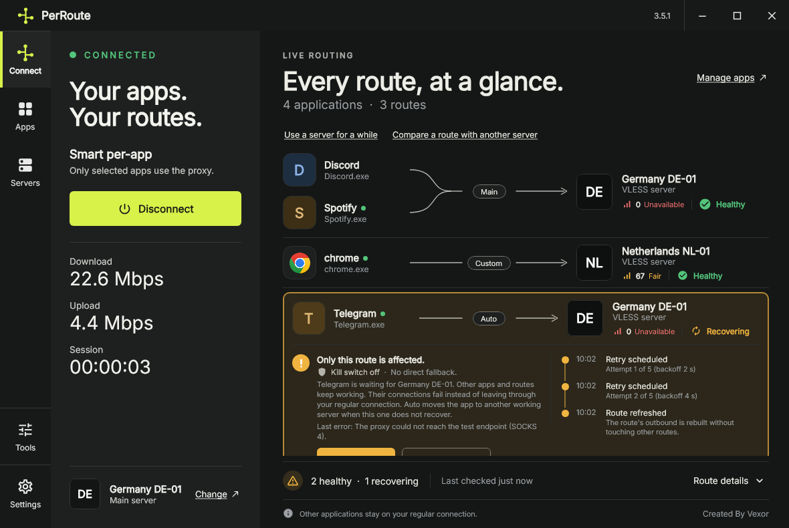
  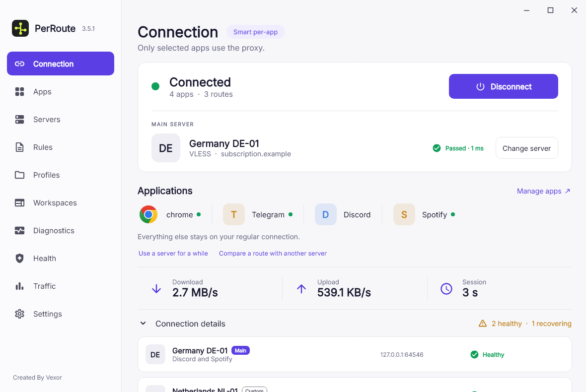
</p>

### Connection

Shows the connection state, the active mode, live download and upload speed, session duration, the main server's latency, and one row per route in use with the applications on it and its own health. A dot marks the selected applications that are sending traffic right now.

**Use a server for a while** puts one app on another server for 15 minutes to 4 hours and brings it back by itself; **Compare a route with another server** opens the same sites through both, side by side, without touching the live route.

With route monitoring on (*Settings > Routing*), each route is checked through its own port once a minute. A route that stops answering shows **Recovering** with the attempt number and a countdown; it expands to say that only this route is affected, whether the kill switch is holding its apps, that there is no direct fallback, and a short recovery timeline. **Retry now** checks it again at once. Healthy routes keep running and are not restarted.

<p align="center">
  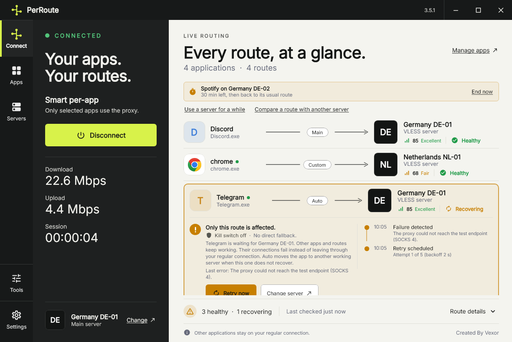
  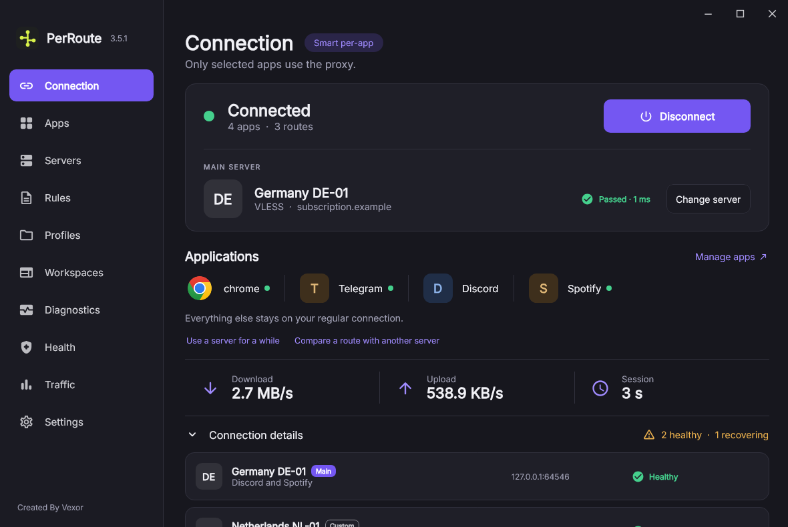
</p>

### Servers

Add and update subscriptions, filter by subscription, favorites, tag or country, search, and sort by latency or quality. Each server shows its ping, measured download speed and **network quality** (score, label and freshness), and carries a badge when it is the main server, a favorite, or tagged. Expand a server to see what its score is made of: latency, jitter, success rate, stability, tunnel setup time, when it was last tested, the confidence, and a sentence explaining the result. Star a server to make it a favorite. The tag button on each row lists your existing tags, so a server goes into one with a single click; **New tag** creates another, and **No tag** clears it. Click a speed chip to test only that server. Select a server and choose **Use as main server** to make it the main route; this also works while connected.

<p align="center">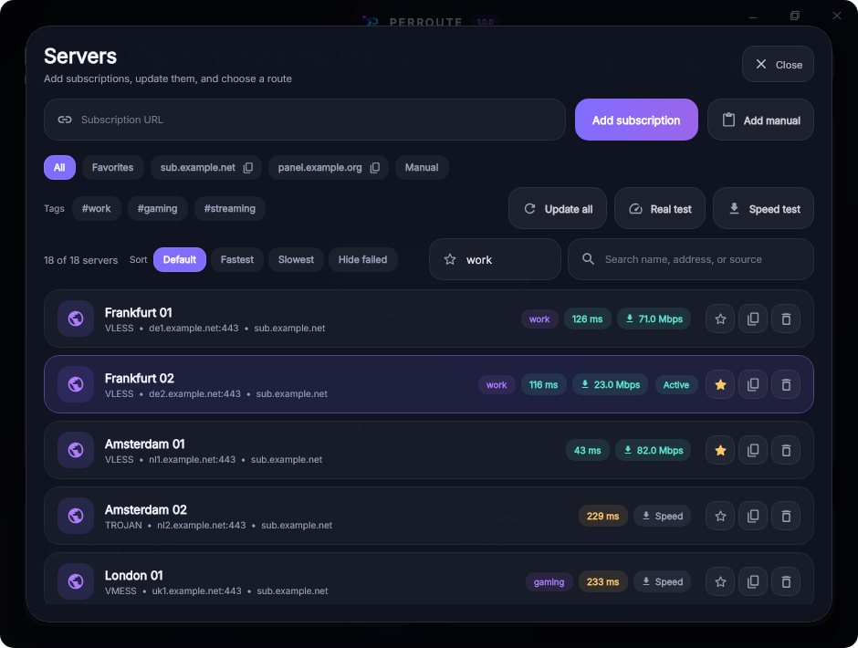</p>

Select a subscription and open its details for the provider's **usage, quota and expiry**, its update interval and the history of every update (servers added, removed and changed). Expired, used-up, failing or suddenly changed subscriptions are flagged. The **Test servers** menu also runs the **gaming test**, and **Best for gaming** sorts by it.

- **Add servers** takes a subscription URL, pasted share links, or a QR code (image, clipboard or camera). Whatever you choose is only read first: you see the servers that were found and any entries that could not be parsed before anything is saved. The camera stays off until you start it.
- **Real tunnel test** starts an isolated Xray instance per server and verifies actual traffic through the tunnel.
- **Speed test** downloads a bounded test file through each server, one at a time. After every ping pass the 10 best servers without a result are measured automatically (up to 10 MB each). This can be turned off under *Settings > Automation*.
- Servers are de-duplicated by their effective configuration, not by name.

<p align="center">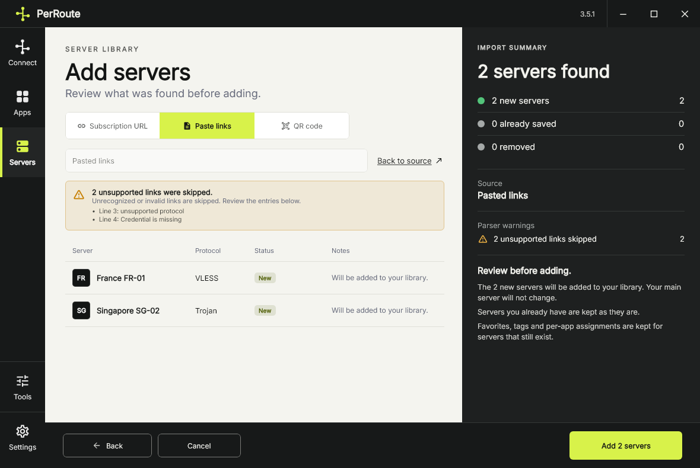</p>

### Apps

Choose from installed applications, running applications, or browse for any executable. Or skip this screen: right-click a program or its shortcut in Explorer and choose **Route with PerRoute** (on Windows 11 under *Show more options*). A small window asks which server it should use and saves the route; while connected, it reconnects once to apply it. Multi-process applications appear once. Microsoft Store apps are found at their current version after the Store updates them, so they keep their selection, route and icon. Changes are staged: nothing is applied until you choose **Save changes**, and leaving the screen with unsaved edits asks whether to save or discard them.

Select an application to open its panel on the right: its route mode, the current decision and the reason for it, and its **bandwidth limit** (download and upload in megabits per second, or unlimited). Limits are saved and applied at once, even while connected; the panel says whether the limit is **Enforced**, **Throttling**, **Pending** (applies when you connect) or **Not enforced** and why.

<p align="center">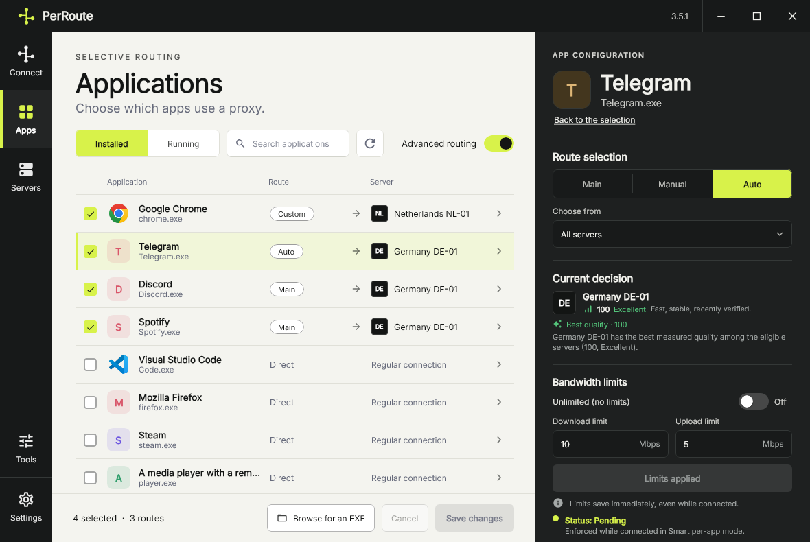</p>

### Advanced routing: a server per app

Advanced routing is optional and **off by default**. While it is off, every selected application uses the main server and no per-app server controls are shown.

Turn it on in **Apps** or under *Settings > Connection* (both switch the same setting) and each selected application gets three modes. **Main** (the default) follows the main server. **Manual** uses a server you pick, shown as a **Custom** route. **Auto** lets PerRoute pick a server for that application from the quality scores. Applications you did not select stay direct.

How **Auto** behaves:

- Each Auto application is decided on its own and gets a route of its own, so its server can change without touching any other application.
- It only picks servers whose score is backed by measurements; an unmeasured server is never treated as healthy. Until any server has data, the app uses the main server and says so.
- It keeps a working server unless another one is better by the switch margin (10 points by default) and the cooldown since the last change (10 minutes by default) has passed. Both are set in *Settings > Routing*.
- When its route fails and does not recover, it moves to the best working server right away (at most once a minute). With no working alternative it keeps its server: it is never released to the direct route.
- You can restrict the choice to your favorites or to one tag. The current choice survives a restart.
- Manual choices are never changed automatically. Auto is off for every application until you choose it.

<p align="center">
  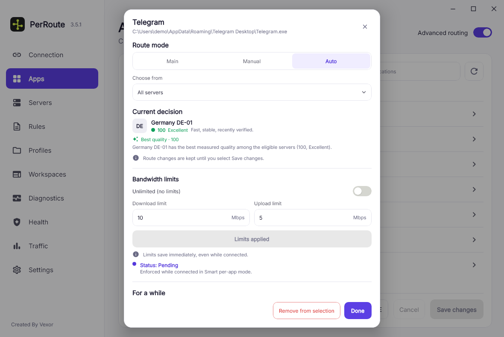
</p>

- Turning Advanced routing off does not delete anything. Your custom choices are kept and apply again when you turn it back on.
- Custom servers apply in Smart per-app mode. System proxy and Local proxy keep them saved and ignore them.
- Routes and the Advanced switch can be changed while disconnected only.
- If an application's custom server is removed, or disappears from a subscription, the application is neither moved to the main server nor released to the direct route. PerRoute asks you to choose a replacement before it connects. While Advanced routing is off, such a leftover choice does not block anything.
- Every server has its own check. A passing main server says nothing about a custom one, and results older than five minutes are marked stale.
- All servers share one Xray process. When route monitoring or an Auto app is in use, a change to one route (switching the main server, an Auto failover, rebuilding a stuck route) replaces only that route's outbound in the running core: other routes keep their connections. Embedded Xray profiles, and a switch to a server that is also another app's custom server, still restart the core and briefly interrupt every routed application. Manual servers are never switched or failed over automatically.
- Any saved server can be a custom server, including embedded Xray JSON profiles. A custom profile keeps its own outbounds, balancers, observatory and rules, and its rules apply only to the applications on it. Sections that Xray has only once per process (DNS, policy) come from the main server.
- If Xray rejects one of the servers, PerRoute does not connect and names that server and the application using it.
- In the picker, favorites are listed first and marked with a star; with many servers a filter field appears.

### Routing rules

Rules apply to all routed applications or to a single one. They are evaluated top to bottom and the first match wins; use the arrows to reorder your rules, and the side panel to add or edit one. **Proxy** sends a connection through the application's own server: its custom server, or the main server when it has none.

<p align="center">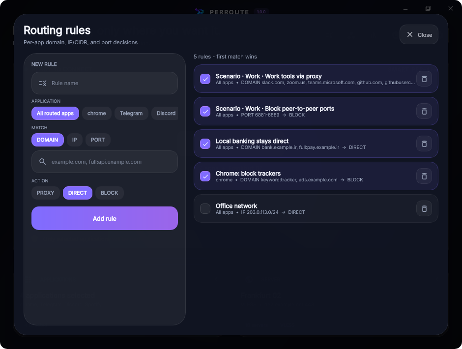</p>

| Match | Examples |
|---|---|
| Domain | `example.com` (the domain and its subdomains), `full:api.example.com`, `keyword:tracker`, `geosite:netflix` |
| IP | `203.0.113.0/24`, `geoip:ir` |
| Port | `80,443,1000-2000` |

### Profiles and presets

A **preset** is a ready-made bundle. It sets the automation switches and adds its own rules above yours without touching your applications, servers, app routes, connection mode, or existing rules. **Preview changes** lists exactly what it would change before you apply it, and **Remove preset rules** takes its rules out again.

| Preset | Kill switch | Fastest on connect | Rules it adds |
|---|---|---|---|
| Work | On | Off | Collaboration tools always proxied; peer-to-peer ports blocked |
| Gaming | Off | On | Game download CDNs stay direct |
| Streaming | On | Off | Streaming services always proxied |

A **profile** saves your own applications, main server, mode, Advanced routing with its app routes, and rules together, so you can switch whole setups at once with **Apply**. Apply a preset first and save a profile to keep it.

<p align="center">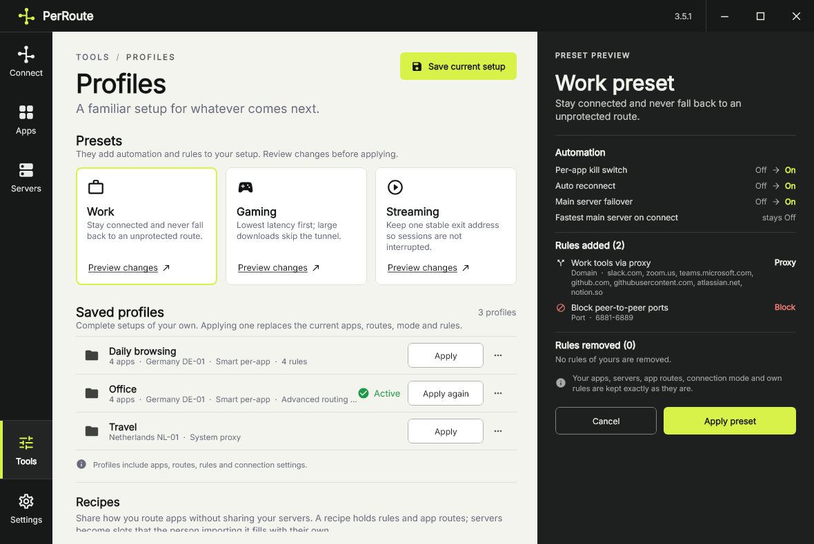</p>

**Recipes** (*Profiles > Recipes*) share your rules and app routes as a file or one line of text, without servers, addresses, links, passwords or folders. Importing shows every change first and can be undone.

<p align="center">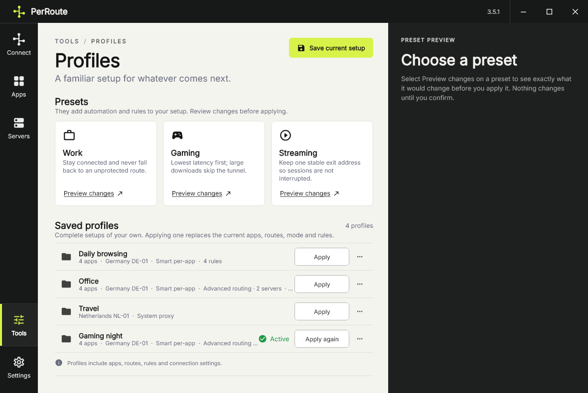</p>

### Workspaces

A browser profile of its own for work, personal use or anything else, each on a route of its own, with DNS, QUIC and WebRTC kept inside it. Works with Chrome, Edge, Brave, Vivaldi and Chromium.

<p align="center">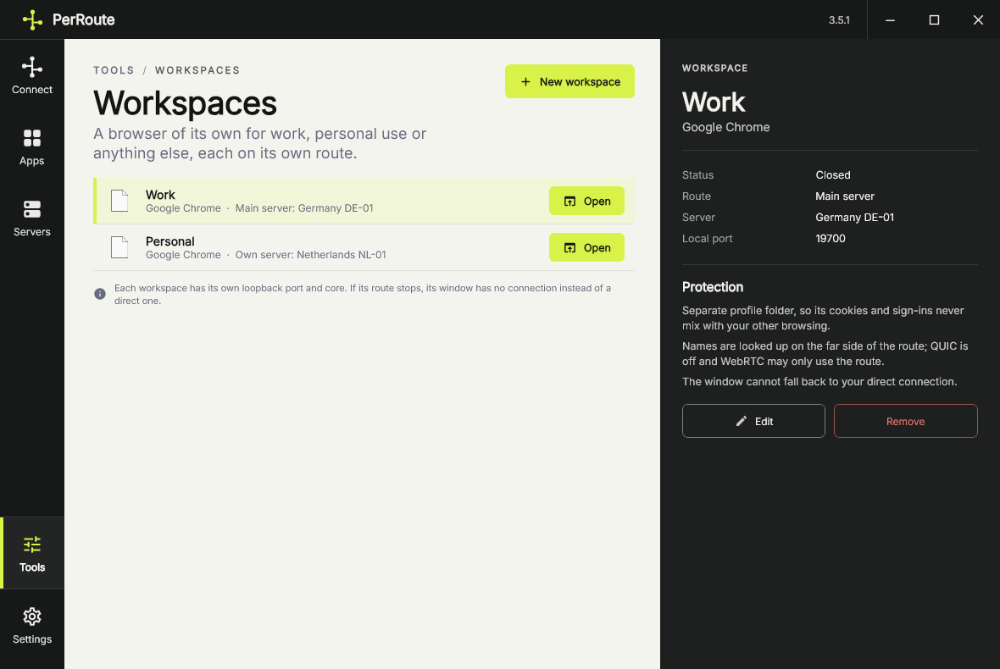</p>

### Diagnostics

The **Inspector** tab lists the live connections of the selected applications in Smart per-app mode: application, destination (with the domain the core sniffed), protocol, route, status, live traffic and last activity, with search and filters by app, route and status. It refreshes every two seconds and can be paused. Selecting a connection shows three separate blocks: **Configured** (what your rules and assignments say should happen, a prediction), **Observed** (what the running core logged for this connection: its outbound and the rule that matched) and **Verified** (the last external check of that route). Nothing is written to disk and no payload is ever read; with the traffic gateway off, rows come from the core's log only and carry no byte counts.

**Run checks** looks up the public IP and country of the direct route and of every server in use, each through its own connection, and records when it last passed or failed. The system DNS section shows the resolvers Windows uses; they describe the computer, not a single server. The rule tester tells you which rule and which server a destination would get, and while connected every rule shows whether it is loaded in the running core.

<p align="center">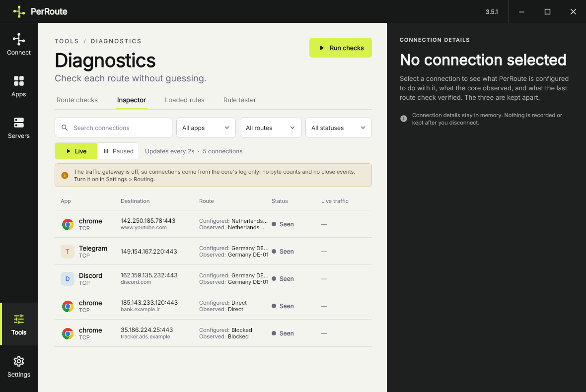</p>

> [!NOTE]
> Diagnostics report what public servers observed at that moment, and the rule tester predicts a routing decision without opening a connection. Neither captures packets, and neither is a substitute for a dedicated leak test.

### LAN Bridge

*Tools > LAN Bridge* lets a phone, tablet or TV on your Wi-Fi use this computer's connection through your main server. Add a device, choose the network and how long to share (one hour, four hours or until you stop), and start sharing. **Set up** shows a code that proxy apps on Android and iPhone can scan, plus the server, port, user name and password to enter by hand. An iPhone or iPad also works without an app: *Settings > Wi-Fi > (i) > Configure Proxy > Manual*, with Authentication on. Android's own Wi-Fi proxy cannot send a password, so it needs a proxy app.

- Every device has its own port and random password. **Remove** makes that password stop working at once; other devices reconnect within a moment.
- The list shows which devices are active, the address they connect from and the sites they opened recently. Nothing is written to disk.
- Sharing listens only on the network you chose, works only on networks Windows treats as private, and stops when the time is up, when PerRoute closes or when the computer leaves that network. The first start asks once for Administrator approval to add a Windows Firewall rule for PerRoute's sharing ports, limited to private networks and to the copy of Xray that comes with PerRoute.
- Shared devices cannot reach this computer or other devices on your network through it, and sharing follows the main server when you change it.

### Health

The **Connection Doctor** takes an app (and optionally a site) that does not work and checks from the outside in: your connection, DNS and clock, the core and the per-app engine, the Windows proxy, the server, the tunnel and the rule for the site. It names the most likely cause and offers a repair that runs only after you confirm. The **Safety Center** tests every route's exit address, explains where name lookups go, and finds rules that are not loaded or can never apply.

<p align="center">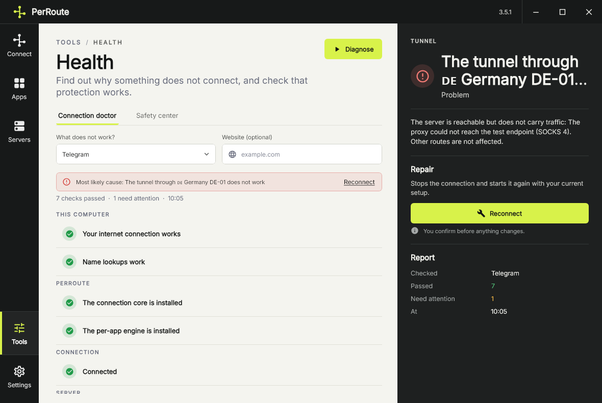</p>

### Traffic

A live speed graph for the last 90 seconds, with exact values under the pointer, and download/upload totals for today, for the month, per day and per application. Totals are byte counts only: there is no per-server or per-destination history.

**Bandwidth by app** lists every selected application with its current rate, session totals, limits, how much of each limit it is using, and whether the limit is enforced or throttling right now. Limits can be edited or removed from each row.

<p align="center">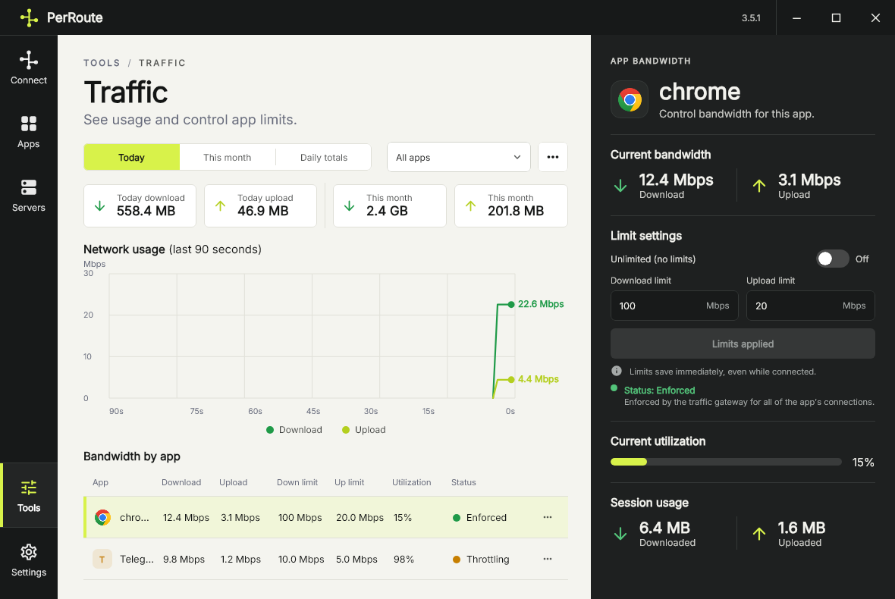</p>

### Settings

Grouped into General (design, theme and reset), Connection (mode and Advanced routing), Routing (background quality checks, Auto margin and cooldown, route monitoring, the traffic gateway, Block QUIC), Automation, Updates, Components, Backup & Restore, Local network, Recovery, and a selectable Activity log.

**Updates** is automatic: PerRoute checks the official releases at start and every six hours, downloads and verifies a new version, and offers **Restart and update**. Windows asks for Administrator approval once, the installer updates the existing folder without further questions, and the new version opens by itself. **Update automatically** turns the download off (new versions are then only shown); the feed field can stay empty, or hold a signed feed of your own. A portable copy is offered the normal installer instead. **Local network** lists your networks and devices, keeps names such as `printer.local` on your network, and lets you mark a network as not trusted so routed apps cannot reach its devices. **Recovery** holds the Network Time Machine (snapshots of the settings PerRoute touches, a comparison that says who changed what, and a restore of PerRoute's own leftovers) and the rollback to the previous version. **PerRoute Recovery** in the Start menu does the same when PerRoute itself does not open.

**Backup & Restore** writes a `.prb` file with the parts you choose: subscriptions, manual servers, app assignments (with route modes and bandwidth limits), rules, profiles and preferences. Encryption with a password is on by default (AES-256-GCM, key derived with PBKDF2-HMAC-SHA256 and 600,000 iterations; every header field is authenticated). Restoring shows a preview first: what the backup contains, whether it is compatible, which applications are missing on this computer (with a way to point to their new location, or skip them), and **Merge** (adds what is new, keeps everything you have, including preferences) or **Replace** (replaces the parts the backup contains). A rollback snapshot is written before anything changes, the restore is applied in one step, and **Undo last restore** brings the previous setup back. Restoring works while disconnected.

**Reset everything** under *Settings > General* returns PerRoute to how it was when first installed: it clears every server and subscription, the selected applications and their routes, rules, profiles, the traffic history and all settings. It asks for confirmation, works only while disconnected, and cannot be undone. Installed components are not touched.

<p align="center">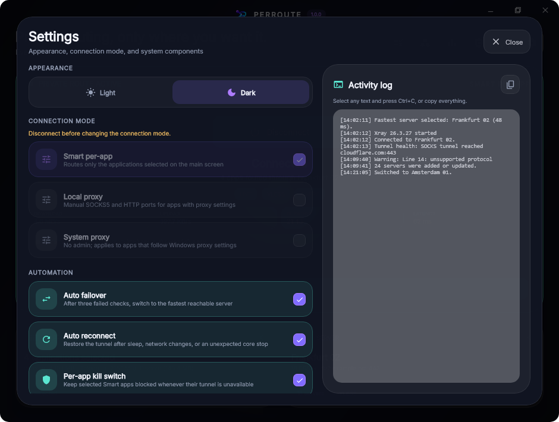</p>

<p align="center">
  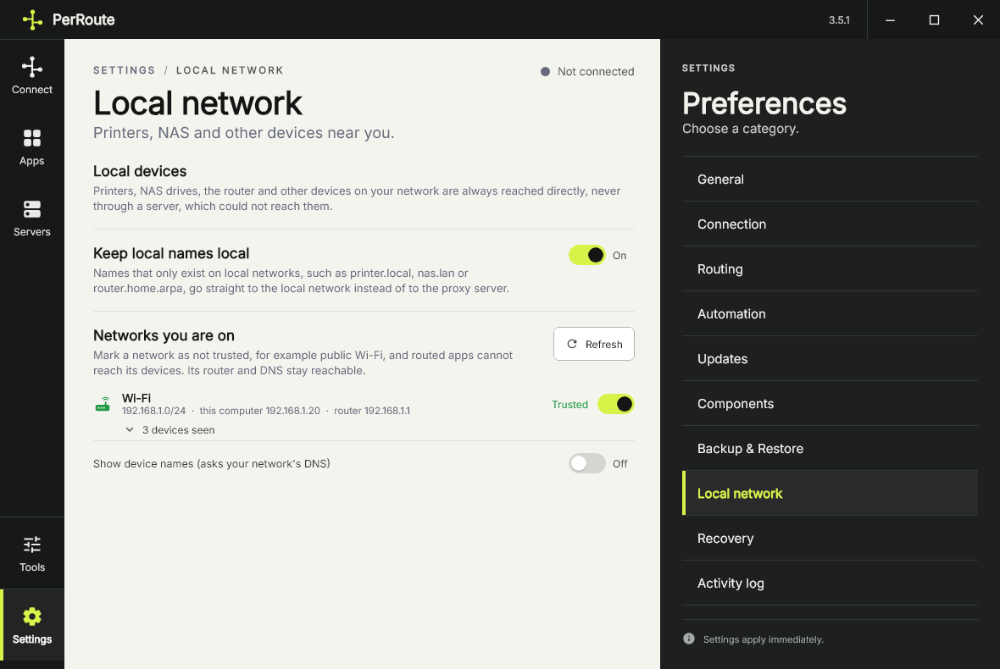
  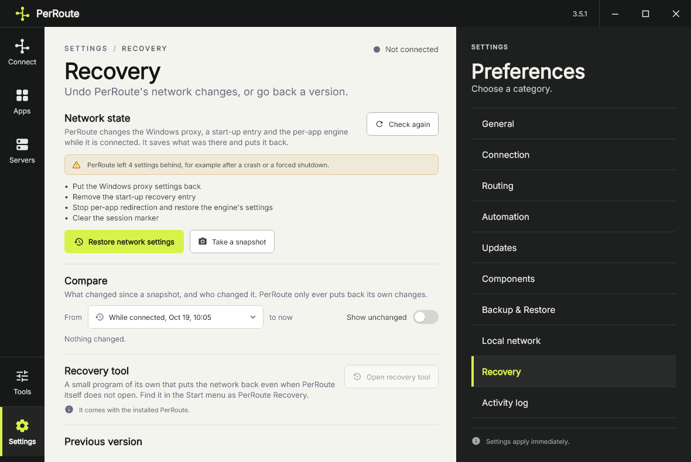
</p>

### Quick Access

Closing or minimizing the main window keeps PerRoute in the notification area. Clicking the tray icon opens Quick Access, where you can connect, switch the main server, and reopen the main window. The list starts with the servers in use (the main server, then any custom servers), followed by your favorites and then the rest. Jumping to the fastest server, **Use a server for a while** (one app on another server, for a limited time) and quitting are in its overflow menu; apps on a temporary server are listed with the time left and an End link. With Advanced routing on it shows how many applications and servers are involved; app routes themselves are edited in the main window.

<p align="center">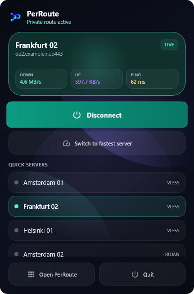</p>

### New in 3.5: where to find it

| Feature | Where |
|---|---|
| Temporary servers | An app's panel in Apps, the Connection screen, a server's menu in Servers, Quick Access |
| Compare with a live route | A server's menu in Servers, the Connection screen |
| Gaming test, Best for gaming | Servers: Test servers menu, a server's menu and its details, the sort menu |
| Subscription details | Servers: select a subscription, then the details button next to it |
| Recipes | Tools > Profiles > Recipes (New), Profiles > Recipes (Simple) |
| Browser workspaces | Tools > Workspaces (New), Workspaces (Simple) |
| Connection Doctor, Safety Center | Tools > Health (New), Health (Simple) |
| Local network | Settings > Local network |
| LAN Bridge | Tools > LAN Bridge (New), LAN Bridge (Simple) |
| Quick Route | Right-click a program in Explorer; *Settings > General* turns the menu entry on or off |
| Resource saving | Settings > Automation |
| Network Time Machine, rollback | Settings > Recovery; **PerRoute Recovery** in the Start menu |

See [docs/releases/v3.5.0.md](docs/releases/v3.5.0.md) for how each works and its limits.

## Browser extension

The extension brings PerRoute into Chromium browsers. Where the app routes Windows applications, the extension routes sites, and it works without the app.

- **This site:** the toolbar button shows where the current site goes. One click sends it through the tunnel, directly or nowhere, for good or for 15 minutes to 4 hours, and through the main server or one of its own.
- **Servers:** subscriptions (with usage, expiry and history), links, Xray JSON and QR codes. Real tests through each server, TCP ping, speed tests, the same quality score as the app, favorites and tags, and a side-by-side comparison with the live route.
- **Rules:** sites, IP ranges and ports; everything through the tunnel or only selected sites; local names stay local. Presets, shareable recipes and profiles.
- **Protection:** kill switch, WebRTC protection, automatic failover, and DNS resolved on the server for tunnel sites.
- **Doctor:** checks the runtime, the server, the live route and the exit address, and shows every host a tab contacts.

To install it, run `PerRoute-Setup-3.5.1.exe` and choose **Browser extension**. The installer puts the runtime in `C:\Program Files\PerRoute Browser`, registers it with your browsers and shows the last step: open the extensions page, turn on Developer mode and choose **Load unpacked** with the `extension` folder. Developer documentation is in [browser/README.md](browser/README.md).

## Connection modes

| Mode | What it routes | Administrator | Notes |
|---|---|---|---|
| **Smart per-app** | Only the applications you select | Once, at install time | Works for applications with no proxy settings. Requires the per-app engine installed by the Full Installer. |
| **System proxy** | Applications that follow Windows proxy settings | Never | The previous Windows proxy settings are saved and restored exactly. |
| **Local proxy** | Applications you configure yourself | Never | SOCKS5 on `127.0.0.1:17890`, HTTP on `127.0.0.1:17891`. Nothing system-wide is changed. |

Connection modes, the app selection, app routes and rules cannot be changed while connected. Switching the main server and changing bandwidth limits are always available.

### Traffic gateway and bandwidth limits

In Smart per-app mode the per-app engine sends every connection of a selected application to a loopback port of its own. With the **traffic gateway** on (*Settings > Routing*), PerRoute listens on that port and passes each connection on, unchanged, to the application's own inbound in the core. Because every connection of an application passes the same place, PerRoute can:

- enforce one download and one upload limit for the application as a whole (all connections together, TCP and UDP), with a token bucket that holds at most 100 ms of traffic;
- count the application's bytes exactly, without polling the core's statistics every second;
- give the connection inspector each connection's destination, byte counts and open/closed state.

The gateway understands just enough SOCKS5 to read destinations and to carry UDP associations through its own relay. It never reads or stores payload, and routing decisions (server, rule, direct or block) stay with the core. Limits:

- Limits apply in Smart per-app mode only. System proxy and Local proxy have no per-application path, so their limits show **Not enforced**.
- Applications that are not selected are not routed through PerRoute and cannot be limited.
- The gateway adds a loopback hop. On loopback, one download through the gateway and the core reached 2.4–2.5 Gbps against 3.4–3.7 Gbps through the core alone (see [Speed](#speed)): far above any internet connection, so it does not limit real downloads. UDP associations use 4 MB socket buffers, so bursts are queued rather than dropped.
- Priority classes (High/Normal/Low) are not offered: without a shared bottleneck they cannot be enforced honestly.

The gateway and the switch are part of the data path, so it can only be turned on or off while disconnected.

## Speed

PerRoute's own data path was measured on loopback, with an isolated Xray core and no internet involved, so only PerRoute's overhead counts:

| Path | One download | 8 at once |
|---|---|---|
| Xray alone | 3.4–3.7 Gbps | 6.6–6.9 Gbps |
| Traffic gateway, then Xray | 2.4–2.5 Gbps | 4.8–5.0 Gbps |

Both are many times faster than home or mobile connections. What made routed browsers and YouTube slower than in system-proxy clients was QUIC: in Smart per-app mode they sent QUIC (UDP) through the tunnel, and a server's TCP transport (gRPC, WebSocket, TCP+TLS, Reality) carries it poorly. **Block QUIC** (*Settings > Routing*, on by default) makes them use TCP, as they do behind a system proxy. If speed is still lower than expected:

- turn off *Automatic speed tests* (*Settings > Automation*) on slow or metered connections; they download up to 10 MB from each of the 10 best servers after a ping pass;
- compare servers in **Servers** or with **Compare a route with another server**; DNS and the domain strategy come from your server or profile, as in other Xray clients.

## Upgrading from 2.x

PerRoute 3 reads version 2 settings as they are. Nothing about your routing changes until you choose to:

- No application is in Auto mode, and every application is unlimited.
- On an installation upgraded from 2.x, background quality checks, route monitoring and the traffic gateway start **off**; turn them on in *Settings > Routing*. A fresh installation starts with them on.
- Without route monitoring or an Auto app, the core keeps the read-only statistics API of version 2, and switching the main server restarts the core as before.
- Profiles saved by version 2 still apply; they never put an application in Auto mode.
- The new settings are written alongside the old ones. Running version 2 again afterwards ignores them (and drops them on its next save).

The tunnel health check is stricter in 3.0: a route only passes when an HTTP request sent through it gets an answer from the far side. In 2.x a SOCKS acknowledgement from the local core was enough, which also passed for a server that was down.

## Security and privacy

- **Saved state is encrypted** with AES-256-GCM. The key is wrapped with Windows DPAPI for the signed-in account, so the state file cannot be opened from another Windows account or machine.
- **No telemetry.** PerRoute talks only to your subscription URLs, your proxy servers, the endpoints used by the tests you start, and the update feed: the official GitHub releases, or the feed you enter. The update check is a plain HTTPS download of the signed manifest.
- **Traffic history is local** and stores byte totals only, never destinations.
- **Updates are verified.** Only an HTTPS manifest signed with the project's offline Ed25519 key is accepted, and the installer's size and SHA-256 are checked before it is used. An update is never installed without your **Restart and update** and Windows' Administrator prompt.
- **Pinned dependencies.** The Full Installer embeds unmodified, hash-verified copies of ProxiFyre, Windows Packet Filter and the Visual C++ Runtime.
- **Loopback only.** Local proxy, gateway and statistics ports listen on `127.0.0.1`. Loopback ports are not separated between Windows accounts: on a computer shared by several signed-in users, another user could use the local proxy ports, and, while route monitoring or an Auto app is in use, the core's routing API (which has no authentication). On a single-user computer this changes nothing.
- **Backups protect credentials.** Server credentials are inside a backup. Encrypted backups use AES-256-GCM with a password-derived key (PBKDF2-HMAC-SHA256, 600,000 iterations, random salt and nonce) and authenticate every header field; the password is never stored or logged. An unencrypted backup is only checksummed and should be kept like a password file.
- **The inspector keeps nothing.** Connections are held in memory, bounded (1,500 entries, closed ones for two minutes) and cleared on disconnect. Quality history stores server keys, times and latencies only.

### What happens if PerRoute stops unexpectedly

| Situation | Result |
|---|---|
| Normal exit, Windows sign-out, restart or shutdown | Windows proxy settings are restored and the core is stopped. |
| Forced close in System proxy mode | A small guard process restores the previous Windows proxy settings within seconds. Traffic returns to the direct route. |
| Power loss or sudden restart in System proxy mode | Windows restores the previous proxy settings at the next sign-in, before PerRoute is opened. |
| Unexpected stop in Smart per-app mode | Other applications are unaffected. With the kill switch on, selected applications stay blocked until PerRoute reconnects; with it off, they are released the next time PerRoute starts. With the traffic gateway on, the gateway stops together with PerRoute, so selected applications have no connection (they are not sent direct) until PerRoute starts again. |
| One route's server stops answering | Only the applications on that route are affected; they wait instead of falling back to the direct route. With route monitoring on, the route is retried with growing delays, rebuilt in place, and re-checked every two minutes until it answers; Auto apps move to another working server. |

## Build from source

**Prerequisites**

- Windows 10 or 11 x64
- JDK 21
- .NET Framework 4.x (only for building the installer; it ships with Windows)

**1. Get the Xray core.** The core binaries are not stored in this repository. Download the Windows 64-bit package from the [Xray-core releases](https://github.com/XTLS/Xray-core/releases) and place `xray.exe`, `geoip.dat`, `geosite.dat` and `wintun.dll` in `tools/xray/`.

**2. Run the tests.**

```powershell
.\test.ps1
```

The suite includes the connection logic of the controller, run against a fake machine so that no Xray process, driver or proxy setting is touched. When the Xray core is present in `tools/xray/`, generated configs are also validated with `xray run -test`, and an end-to-end test runs the real core and the traffic gateway on loopback against local VLESS servers: per-app routing, an in-place main switch that keeps another app's open connection, Auto failover when a server stops, an end-to-end bandwidth limit, and inspector observations from the core's own log. All of its ports are shifted (`-Dperroute.portOffset=20000`), so it can run next to an installed PerRoute; it never touches the per-app driver or Windows proxy settings.

To review the interface without a display, render every screen of both designs off-screen with demonstration data (baseline size, narrow size, 150% scaling, both themes) into `build/ui-snapshots/`:

```powershell
.\gradlew.bat renderUiSnapshots
```

**3. Run from source.**

```powershell
.\gradlew.bat run
```

**4. Build the release packages.**

```powershell
.\package.ps1
```

This produces the following in `dist/`:

| Output | Description |
|---|---|
| `PerRoute-Setup-3.5.1.exe` | Offline installer with the per-app engine |
| `PerRoute-Portable-3.5.1.zip` | Self-contained portable build |
| `PerRoute-Browser-3.5.1.zip` | The browser runtime and extension (embedded in the installer) |
| `PerRoute-3.5.1/` | Unpacked application image |

The installer dependencies are downloaded on first use and verified against pinned SHA-256 digests. Building the browser extension also needs Node.js and Rust; see [browser/README.md](browser/README.md).

### Project layout

```
src/main/kotlin/app/perroute/compose   User interface (Compose Desktop) and application controller
src/main/kotlin/app/perroute/runtime   Quality measurements and per-route recovery scheduling
src/main/java/app/perroute/model       Servers, rules, profiles, bandwidth policies, application state
src/main/java/app/perroute/parser      Share-link and subscription parsers
src/main/java/app/perroute/service     Xray, per-app engine, system proxy, probes, updates
src/main/java/app/perroute/quality     Network quality scoring and history
src/main/java/app/perroute/routing     Route modes, Auto server selection, route health
src/main/java/app/perroute/gateway     Traffic gateway and rate limiting
src/main/java/app/perroute/inspector   Core log parsing and the in-memory connection table
src/main/java/app/perroute/backup      Backup format, encryption, preview and restore planning
src/main/java/app/perroute/netstate    Network snapshots, comparison and safe restore plans
src/main/java/app/perroute/update      Startup health and the installation kept for a rollback
src/main/java/app/perroute/subscription Subscription usage, expiry and change history
src/main/java/app/perroute/gaming      Gaming probe and score
src/main/java/app/perroute/shadow      Side-by-side comparison of a route and a candidate
src/main/java/app/perroute/recipe      Shareable recipes: format, validation and import plans
src/main/java/app/perroute/workspace   Browser workspaces
src/main/java/app/perroute/localnet    Local networks, devices and the trust policy
installer/WindowsRecovery.cs           PerRoute Recovery, the standalone network restore and rollback tool
src/main/java/app/perroute/persistence Encrypted state storage
src/test/java/app/perroute             Test suite
installer/                             Windows installer and uninstaller (C#)
tools/update/                          Update manifest signing tool
browser/                               Browser extension (TypeScript) and its runtime (Rust)
docs/screenshots/                      Images used in this document
```

### Publishing an update

Updates are distributed as a signed manifest next to the installer. Keep the private key outside the repository.

```powershell
java tools\update\UpdateManifestTool.java sign 3.5.1 dist\PerRoute-Setup-3.5.1.exe https://github.com/AliMirzad/PerRoute/releases/download/v3.5.1/PerRoute-Setup-3.5.1.exe release-secrets\perroute-update-private.pk8 dist\update.json
```

Attach `update.json` to **every** release. PerRoute reads it from the latest release by itself, at this address (built in as the default feed):

```
https://github.com/AliMirzad/PerRoute/releases/latest/download/update.json
```

A release without `update.json` makes the update check fail for everyone until one is attached.

The public verification key is pinned in the application; 3.5.1 introduced the current key. Replacing the private key requires shipping a new build, and versions that pin the old key can only move to that build by a manual install. Keep a copy of `release-secrets/perroute-update-private.pk8` somewhere safe outside this computer: without it no further update can be signed.

### Diagnostics

Setting the environment variable `PERROUTE_PERF=1` writes start-up and frame timing marks to `perf.log` in `%LOCALAPPDATA%\PerRoute`. It is off by default.

## Troubleshooting

| Problem | What to check |
|---|---|
| Smart per-app is disabled in Settings | The per-app engine is missing. Install with the Full Installer and approve its single Administrator prompt. |
| A subscription adds no servers | Open *Settings > Activity log* for the parser warnings. Supported formats are VLESS, VMess, Trojan and Shadowsocks share links (plain or Base64) and Xray JSON. |
| Downloads or YouTube are slower than in another client | Keep **Block QUIC** on (*Settings > Routing*) and reconnect. Turn off *Automatic speed tests* on slow connections. See [Speed](#speed). |
| A Microsoft Store app shows a letter instead of its icon, or is not routed | Open **Apps** once (or reconnect): PerRoute looks up the Store app's current version. If the Activity log says it was not found, choose it again in Apps. |
| A selected application keeps its old route after connecting | Existing TCP connections may stay on their previous route until the application opens new ones. Restarting the application forces it. |
| Browsers have no internet after a crash | Open PerRoute once; it restores the Windows proxy settings on start. |
| A bandwidth limit shows *Not enforced* | Limits need Smart per-app mode and the traffic gateway (*Settings > Routing*, switched while disconnected). The status line says which one is missing. |
| An Auto app stays on the main server | No server in its pool has enough quality data yet. Run a ping or a real tunnel test in Servers, or turn on background quality checks. |
| A route shows *Recovering* | Only that route's server stopped answering; other routes are unaffected. Its apps wait (they never fall back to the direct route). Use **Retry now**, choose another server, or wait: a failed route is re-checked every two minutes and comes back by itself. |

## Third-party components

| Component | License | Use |
|---|---|---|
| [Xray-core](https://github.com/XTLS/Xray-core) | MPL-2.0 | Connection and protocol engine |
| [Wintun](https://www.wintun.net/) | WireGuard LLC license | Bundled with the core |
| [ProxiFyre](https://github.com/wiresock/proxifyre) | AGPL-3.0 | Per-application redirection; bundled unmodified in the Full Installer |
| [Windows Packet Filter](https://github.com/wiresock/ndisapi) | See project | Packet filter driver; bundled unmodified in the Full Installer |
| [Compose Multiplatform](https://github.com/JetBrains/compose-multiplatform) | Apache-2.0 | User interface |
| [Java Native Access](https://github.com/java-native-access/jna) | Apache-2.0 | Windows DPAPI binding |
| [ZXing](https://github.com/zxing/zxing) | Apache-2.0 | QR decoding |
| [Inter](https://rsms.me/inter/) | SIL OFL 1.1 | Interface typeface |
| [jsQR](https://github.com/cozmo/jsQR) | Apache-2.0 | QR decoding in the browser extension |

See [THIRD_PARTY_NOTICES.md](THIRD_PARTY_NOTICES.md) for details.

## License

PerRoute is free software, released under the [GNU General Public License v3.0](LICENSE). You may use, study, share and modify it; distributed modifications must remain under the same license and include their source.

Copyright © 2026 Ali Mirzad.

The bundled third-party components listed above are separate works under their own licenses.

## Disclaimer

PerRoute is a network client. You are responsible for using it in accordance with the laws and regulations that apply to you and with the terms of the services you connect to. The software is provided as is, without warranty of any kind.

## Author

Created By **Vexor** · [github.com/AliMirzad](https://github.com/AliMirzad)
