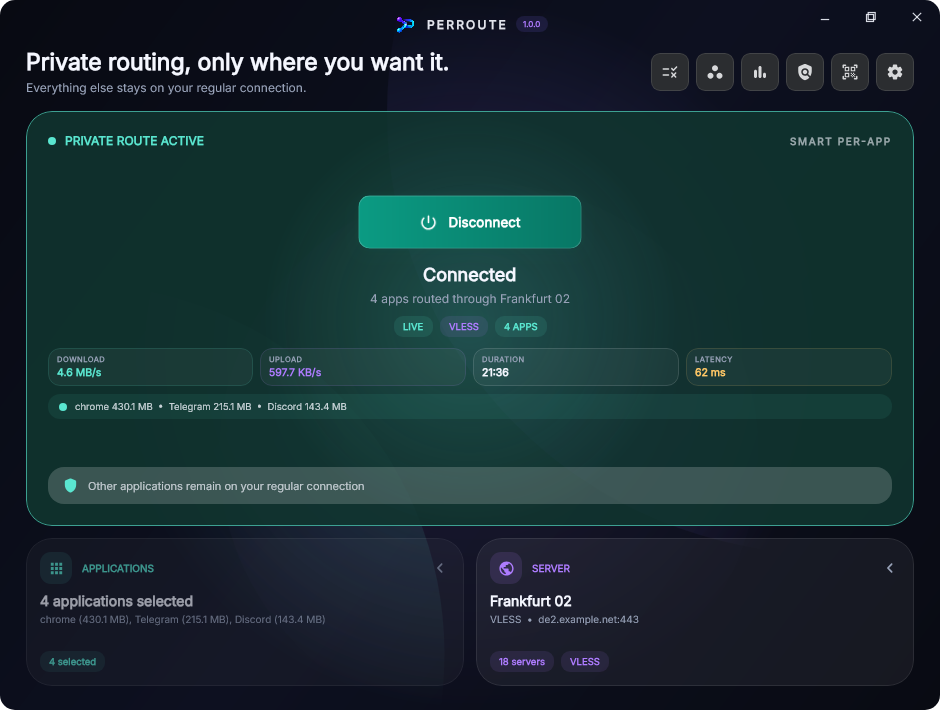
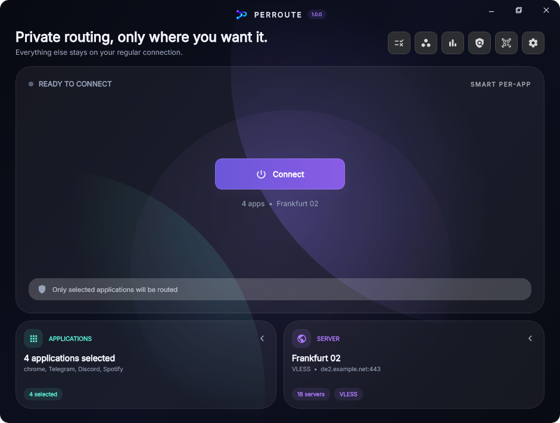
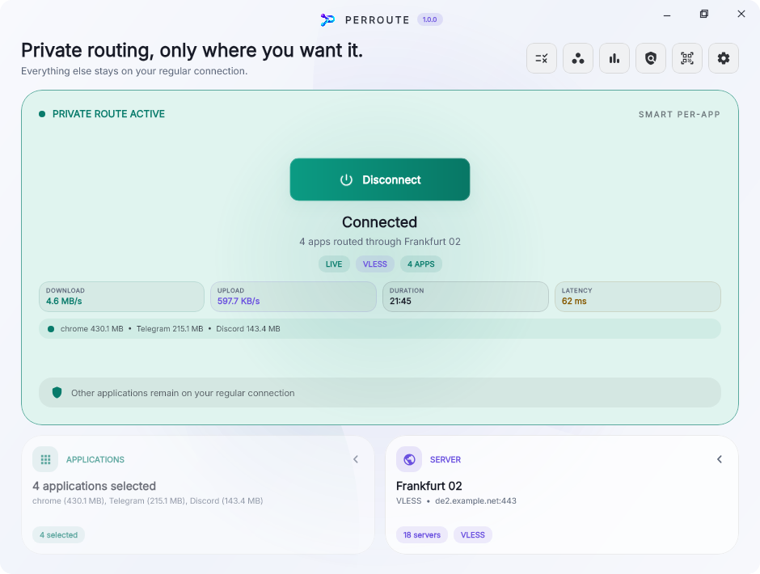
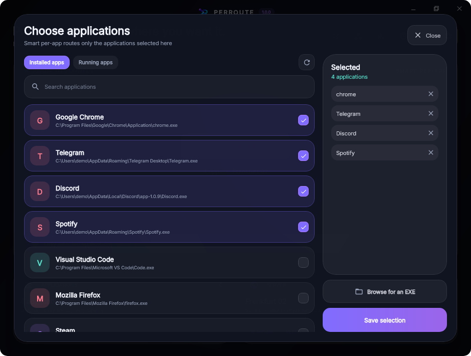
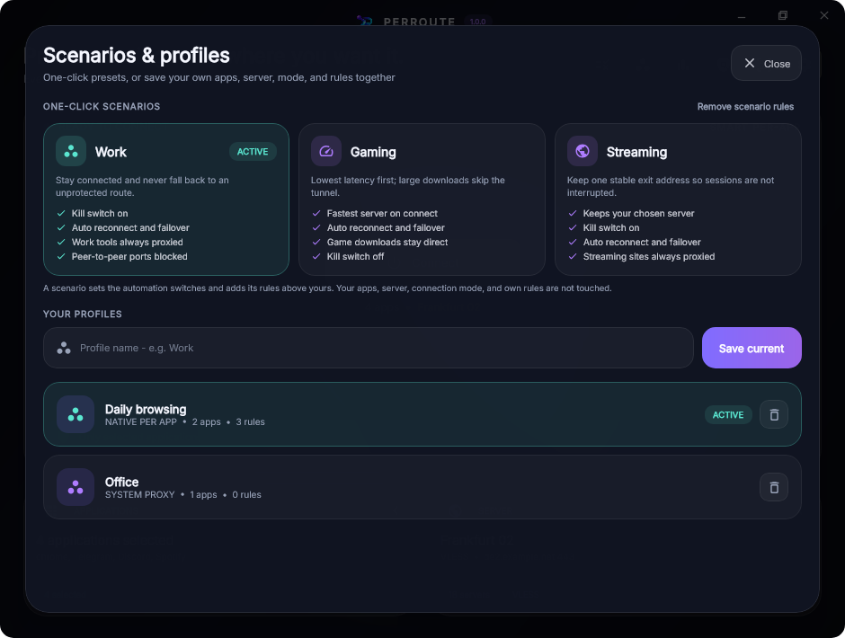
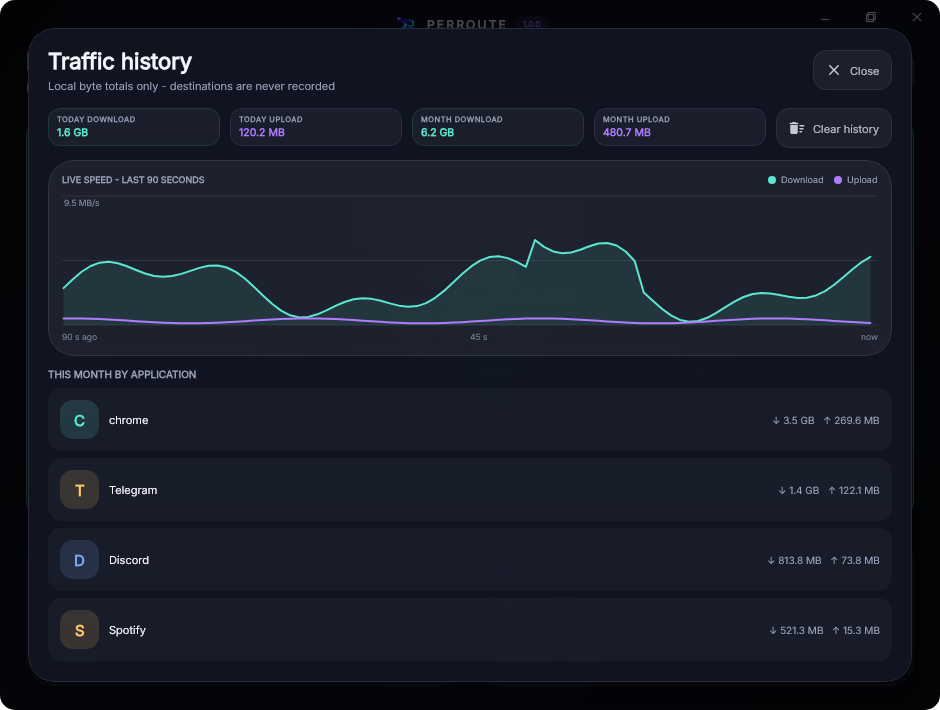

<div align="center">


# PerRoute

**Route only the applications you choose through your proxy. Everything else stays on your regular connection.**

A modern Windows client for VLESS, VMess, Trojan and Shadowsocks, built on [Xray-core](https://github.com/XTLS/Xray-core).


[Download](#download) · [Features](#features) · [Tour](#tour) · [Connection modes](#connection-modes) · [Build from source](#build-from-source)



</div>

---

## Why PerRoute

Most proxy clients are all-or-nothing: either the whole system goes through the tunnel or nothing does. PerRoute is built around the opposite idea. You pick the applications that need the tunnel; the rest of the machine keeps its normal, direct connection. No browser extensions, no per-application proxy settings, and no launching applications from inside the client.

When you do want everything proxied, System proxy and Local proxy modes are one click away.

## Features

| | |
|---|---|
| **Per-application routing** | Route arbitrary Windows applications, including ones with no proxy settings of their own. Already-running applications are picked up without being restarted. |
| **Three connection modes** | Smart per-app, System proxy, and Local proxy (SOCKS5 + HTTP). |
| **Subscriptions** | Import by URL, pasted share links, Xray JSON, or QR code (image, clipboard, or camera). Updates keep your favorites, tags and selection. |
| **Latency and speed tests** | Endpoint ping, a real tunnel test, and a download speed test per server, with sorting and filtering. |
| **Live switching** | Change servers while connected without restarting your applications. A failed switch rolls back automatically. |
| **Auto reconnect and failover** | Recovers after sleep or network changes and moves to a working server when the active one stops responding. |
| **Per-app kill switch** | Keeps selected applications offline whenever their tunnel is unavailable. Other applications are unaffected. |
| **Routing rules** | Per-application rules by domain, IP/CIDR or port with Proxy, Direct and Block actions. First match wins. |
| **One-click scenarios** | Work, Gaming and Streaming presets that set automation and add a small rule set on top of yours. |
| **Profiles** | Save applications, server, mode and rules together and switch between them. |
| **Privacy & routing inspector** | See the public IP of each route, your DNS resolvers, which rules are loaded in the running core, and which rule a destination will hit. |
| **Traffic history** | Live speed graph plus daily, monthly and per-application totals. Stored locally; destinations are never recorded. |
| **Quick Access** | A compact tray panel to connect, switch servers or jump to the fastest one. |
| **Safe recovery** | Windows proxy settings are restored after a crash, forced close, or sudden restart. |
| **Signed updates** | Update manifests are verified against a pinned Ed25519 key; downloads are checked by size and SHA-256. |
| **Light and dark themes** | |

## Download

Get the latest build from the [Releases](https://github.com/AliMirzad/PerRoute/releases/latest) page.

| Package | Use it when |
|---|---|
| `PerRoute-Setup-1.0.0.exe` | You want everything, including Smart per-app mode. The installer asks for Administrator approval once and installs PerRoute together with the per-app engine. |
| `PerRoute-Portable-1.0.0.zip` | You want a no-install build. Extract the folder and run `PerRoute.exe`. System proxy and Local proxy work out of the box; Smart per-app works only if the per-app engine is already installed. |

**Requirements:** Windows 10 or 11, 64-bit. The Java runtime and Xray core are bundled; nothing else needs to be installed.

Verify a download against the SHA-256 values published with each release:

```powershell
Get-FileHash .\PerRoute-Setup-1.0.0.exe -Algorithm SHA256
```

## Quick start

1. Open **Servers**, paste your subscription URL and choose **Add subscription** (or use **Add manual** for share links).
2. Pick a server. Latency appears automatically; the best servers are speed-tested in the background.
3. Open **Applications** and select the programs that should use the tunnel.
4. Press **Connect**.

## Tour

### Dashboard

The main window shows the connection state, the active mode, live download and upload speed, session duration, latency, and which of your selected applications are currently sending traffic.

<p align="center">
  
  
</p>

### Servers

Add and update subscriptions, filter by subscription, favorites, tag or country, and sort by latency. Each server shows its ping and measured download speed. Click a speed chip to test only that server.

<p align="center"></p>

- **Real test** starts an isolated Xray instance per server and verifies actual traffic through the tunnel.
- **Speed test** downloads a bounded test file through each server, one at a time. After every ping pass the 10 best servers without a result are measured automatically (up to 10 MB each). This can be turned off under *Settings > Automation*.
- Servers are de-duplicated by their effective configuration, not by name.

### Applications

Choose from installed applications, running applications, or browse for any executable. Multi-process applications appear once.

<p align="center"></p>

### Routing rules

Rules apply to all routed applications or to a single one. They are evaluated top to bottom and the first match wins.

<p align="center"></p>

| Match | Examples |
|---|---|
| Domain | `example.com` (the domain and its subdomains), `full:api.example.com`, `keyword:tracker`, `geosite:netflix` |
| IP | `203.0.113.0/24`, `geoip:ir` |
| Port | `80,443,1000-2000` |

### Scenarios and profiles

A **scenario** is a one-click preset. It sets the automation switches and adds its own rules above yours without touching your applications, server, connection mode, or existing rules.

| Scenario | Kill switch | Fastest on connect | Rules it adds |
|---|---|---|---|
| Work | On | Off | Collaboration tools always proxied; peer-to-peer ports blocked |
| Gaming | Off | On | Game download CDNs stay direct |
| Streaming | On | Off | Streaming services always proxied |

A **profile** saves your own applications, server, mode and rules together, so you can switch whole setups at once. Apply a scenario first and save a profile to keep it.

<p align="center"></p>

### Privacy & routing inspector

Check what each route actually exposes: the public IP and country of the direct route and of the tunnel, your system DNS servers, and the resolver that public services see. The rule check tells you which rule a destination will hit, and while connected every rule shows whether it is loaded in the running core.

<p align="center"></p>

> [!NOTE]
> The inspector reports what public servers observe at that moment. It does not capture packets and is not a substitute for a dedicated leak test.

### Traffic history

A live speed graph for the last 90 seconds, with exact values under the pointer, and download/upload totals per day, per month and per application.

<p align="center"></p>

### Settings

Theme, connection mode, automation, secure updates, system components, and a selectable activity log.

<p align="center"></p>

### Quick Access

Closing or minimizing the main window keeps PerRoute in the notification area. Clicking the tray icon opens Quick Access, where you can connect, switch servers, jump to the fastest server, reopen the main window, or quit.

<p align="center"></p>

## Connection modes

| Mode | What it routes | Administrator | Notes |
|---|---|---|---|
| **Smart per-app** | Only the applications you select | Once, at install time | Works for applications with no proxy settings. Requires the per-app engine installed by the Full Installer. |
| **System proxy** | Applications that follow Windows proxy settings | Never | The previous Windows proxy settings are saved and restored exactly. |
| **Local proxy** | Applications you configure yourself | Never | SOCKS5 on `127.0.0.1:17890`, HTTP on `127.0.0.1:17891`. Nothing system-wide is changed. |

Connection modes cannot be changed while connected. Live server switching is always available.

## Security and privacy

- **Saved state is encrypted** with AES-256-GCM. The key is wrapped with Windows DPAPI for the signed-in account, so the state file cannot be opened from another Windows account or machine.
- **No telemetry.** PerRoute talks only to your subscription URLs, your proxy servers, the endpoints used by the tests you start, and the update feed you configure.
- **Traffic history is local** and stores byte totals only, never destinations.
- **Updates are verified.** Only an HTTPS manifest signed with the project's offline Ed25519 key is accepted, and the installer's size and SHA-256 are checked before it is used.
- **Pinned dependencies.** The Full Installer embeds unmodified, hash-verified copies of ProxiFyre, Windows Packet Filter and the Visual C++ Runtime.
- **Loopback only.** Local proxy and statistics ports listen on `127.0.0.1`.

### What happens if PerRoute stops unexpectedly

| Situation | Result |
|---|---|
| Normal exit, Windows sign-out, restart or shutdown | Windows proxy settings are restored and the core is stopped. |
| Forced close in System proxy mode | A small guard process restores the previous Windows proxy settings within seconds. Traffic returns to the direct route. |
| Power loss or sudden restart in System proxy mode | Windows restores the previous proxy settings at the next sign-in, before PerRoute is opened. |
| Unexpected stop in Smart per-app mode | Other applications are unaffected. With the kill switch on, selected applications stay blocked until PerRoute reconnects; with it off, they are released the next time PerRoute starts. |

## Build from source

**Prerequisites**

- Windows 10 or 11 x64
- JDK 21
- .NET Framework 4.x (only for building the installer; it ships with Windows)

**1. Get the Xray core.** The core binaries are not stored in this repository. Download the Windows 64-bit package from the [Xray-core releases](https://github.com/XTLS/Xray-core/releases) and place `xray.exe`, `geoip.dat`, `geosite.dat` and `wintun.dll` in `tools/xray/`.

**2. Run the tests.**

```powershell
.\test.ps1
```

**3. Run from source.**

```powershell
.\gradlew.bat run
```

**4. Build the release packages.**

```powershell
.\package.ps1
```

This produces the following in `dist/`:

| Output | Description |
|---|---|
| `PerRoute-Setup-1.0.0.exe` | Offline installer with the per-app engine |
| `PerRoute-Portable-1.0.0.zip` | Self-contained portable build |
| `PerRoute-1.0.0/` | Unpacked application image |

The installer dependencies are downloaded on first use and verified against pinned SHA-256 digests.

### Project layout

```
src/main/kotlin/app/perroute/compose   User interface (Compose Desktop) and application controller
src/main/java/app/perroute/model       Servers, rules, profiles, application state
src/main/java/app/perroute/parser      Share-link and subscription parsers
src/main/java/app/perroute/service     Xray, per-app engine, system proxy, probes, updates
src/main/java/app/perroute/persistence Encrypted state storage
src/test/java/app/perroute             Test suite
installer/                             Windows installer and uninstaller (C#)
tools/update/                          Update manifest signing tool
docs/screenshots/                      Images used in this document
```

### Publishing an update

Updates are distributed as a signed manifest next to the installer. Keep the private key outside the repository.

```powershell
java tools\update\UpdateManifestTool.java sign 1.0.0 dist\PerRoute-Setup-1.0.0.exe https://github.com/AliMirzad/PerRoute/releases/download/v1.0.0/PerRoute-Setup-1.0.0.exe release-secrets\perroute-update-private.pk8 dist\update.json
```

Attach `update.json` to the release. Users enable updates by entering this feed once in *Settings > Secure updates*:

```
https://github.com/AliMirzad/PerRoute/releases/latest/download/update.json
```

The public verification key is pinned in the application. Replacing the private key requires shipping a new build.

### Diagnostics

Setting the environment variable `PERROUTE_PERF=1` writes start-up and frame timing marks to `perf.log` in `%LOCALAPPDATA%\PerRoute`. It is off by default.

## Troubleshooting

| Problem | What to check |
|---|---|
| Smart per-app is disabled in Settings | The per-app engine is missing. Install with the Full Installer and approve its single Administrator prompt. |
| A subscription adds no servers | Open *Settings > Activity log* for the parser warnings. Supported formats are VLESS, VMess, Trojan and Shadowsocks share links (plain or Base64) and Xray JSON. |
| A selected application keeps its old route after connecting | Existing TCP connections may stay on their previous route until the application opens new ones. Restarting the application forces it. |
| Browsers have no internet after a crash | Open PerRoute once; it restores the Windows proxy settings on start. |

## Third-party components

| Component | License | Use |
|---|---|---|
| [Xray-core](https://github.com/XTLS/Xray-core) | MPL-2.0 | Connection and protocol engine |
| [Wintun](https://www.wintun.net/) | WireGuard LLC license | Bundled with the core |
| [ProxiFyre](https://github.com/wiresock/proxifyre) | AGPL-3.0 | Per-application redirection; bundled unmodified in the Full Installer |
| [Windows Packet Filter](https://github.com/wiresock/ndisapi) | See project | Packet filter driver; bundled unmodified in the Full Installer |
| [Compose Multiplatform](https://github.com/JetBrains/compose-multiplatform) | Apache-2.0 | User interface |
| [Java Native Access](https://github.com/java-native-access/jna) | Apache-2.0 | Windows DPAPI binding |
| [ZXing](https://github.com/zxing/zxing) | Apache-2.0 | QR decoding |
| [Inter](https://rsms.me/inter/) | SIL OFL 1.1 | Interface typeface |

See [THIRD_PARTY_NOTICES.md](THIRD_PARTY_NOTICES.md) for details.

## License

PerRoute is free software, released under the [GNU General Public License v3.0](LICENSE). You may use, study, share and modify it; distributed modifications must remain under the same license and include their source.

Copyright © 2026 Ali Mirzad.

The bundled third-party components listed above are separate works under their own licenses.

## Disclaimer

PerRoute is a network client. You are responsible for using it in accordance with the laws and regulations that apply to you and with the terms of the services you connect to. The software is provided as is, without warranty of any kind.

## Author

Created by **Ali Mirzad** · [github.com/AliMirzad](https://github.com/AliMirzad)
